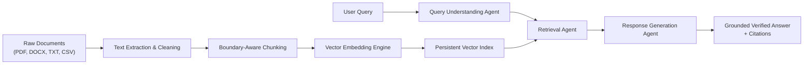
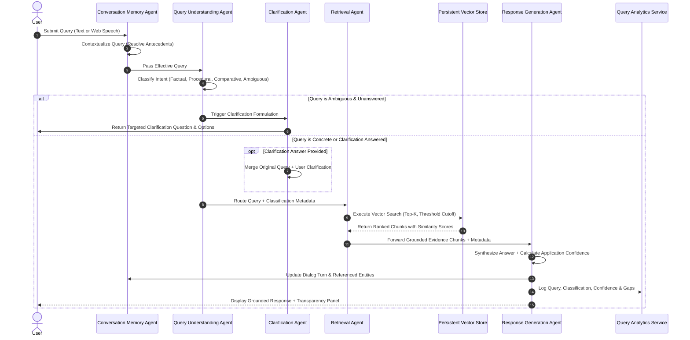

# System Architecture & Technical Specifications

**Project Title:** AI-Based Knowledge Retrieval Platform with Query Resolution System  
**Document Code:** ARCH-SPEC-M1-M4  

---

## 1. Milestone 1.1 — Research & Technical Foundations

### 1.1 Retrieval-Augmented Generation (RAG) Architecture
Retrieval-Augmented Generation enhances generative AI systems by dynamically anchoring prompt synthesis to an external, verifiable knowledge base. Rather than relying on static parametric memory embedded in neural network weights (which suffers from hallucinations and stale training cutoffs), RAG retrieves the Top-$K$ most relevant document chunks based on semantic vector similarity and feeds them as explicit ground-truth context to the response generation engine.



### 1.2 Multi-Agent Query Resolution Patterns
Rather than handling all query processing in a monolithic prompt, this system decomposes the problem into five specialized, collaborative agents:
1. **Query Understanding Agent**: Dissects syntax, semantic intent, domain affinity, and ambiguity.
2. **Clarification Agent**: Intercepts underspecified or multi-part queries before costly retrieval and formulates concise, targeted follow-up prompts.
3. **Retrieval Agent**: Bridges the lexical-semantic query representation with the persistent vector store, applying Top-$K$ ranking and similarity threshold pruning.
4. **Response Generation Agent**: Synthesizes structured, grounded factual, procedural, or comparative answers with strict in-text source attribution.
5. **Conversation Memory Agent**: Maintains multi-turn context without polluting the permanent knowledge base or causing token context explosion.

### 1.3 Mathematical Foundation: Vector Space & Cosine Similarity
Every text chunk $d_i$ and query $q$ is mapped to a unit-normalized vector $\mathbf{v} \in \mathbb{R}^D$ within a sublinear TF-IDF vector space with unigram and bigram tokenization.

The semantic relevance score $S(q, d_i)$ between the query vector $\mathbf{q}$ and document chunk vector $\mathbf{d}_i$ is defined by the dot product of their $L_2$-normalized vectors:

$$\text{CosineSimilarity}(\mathbf{q}, \mathbf{d}_i) = \frac{\mathbf{q} \cdot \mathbf{d}_i}{\|\mathbf{q}\|_2 \|\mathbf{d}_i\|_2} = \sum_{j=1}^{D} q_j \cdot d_{i,j}$$

Because both vectors are $L_2$-normalized ($\|\mathbf{q}\|_2 = \|\mathbf{d}_i\|_2 = 1$), the computation simplifies to a high-speed matrix-vector product:

$$\mathbf{S} = \mathbf{M}_{\text{chunks}} \cdot \mathbf{q}^T$$

where $\mathbf{M}_{\text{chunks}} \in \mathbb{R}^{N \times D}$ is the global embeddings matrix and $\mathbf{S} \in \mathbb{R}^N$ is the vector of similarity scores across all $N$ chunks in the knowledge base.

---

## 2. Milestone 1.2 — System Architecture & Data Flow

### 2.1 Multi-Agent Orchestration Sequence Diagram



---

## 3. Data Schemas & Models

### 3.1 Document Metadata Schema
```json
{
  "id": "doc_8f1a2b",
  "filename": "kyc_aml_compliance_manual.txt",
  "file_type": "TXT",
  "file_size_bytes": 14208,
  "upload_timestamp": "2026-10-15T16:13:40Z",
  "chunk_count": 5,
  "domain": "Finance",
  "status": "indexed",
  "error_message": null
}
```

### 3.2 Chunk Schema
```json
{
  "id": "doc_8f1a2b_c0",
  "document_id": "doc_8f1a2b",
  "filename": "kyc_aml_compliance_manual.txt",
  "domain": "Finance",
  "chunk_index": 0,
  "page_or_section": "1. Regulatory Mandate",
  "text": "Under Bank Secrecy Act and FinCEN directives, all covered institutions must file a Currency Transaction Report (CTR) for each cash transaction exceeding $10,000...",
  "token_count": 48
}
```

### 3.3 Application Confidence Indicator Formula
Unlike arbitrary probability scores, the application-level confidence score $C \in [0.0, 1.0]$ is calculated deterministically through a multi-factor formula:

$$C = 0.50 \cdot s_{\max} + 0.30 \cdot \bar{s} + 0.20 \cdot c_{\text{term}}$$

Where:
- $s_{\max}$: Maximum similarity score among retrieved chunks.
- $\bar{s}$: Mean similarity score of the Top-$K$ retrieved chunks.
- $c_{\text{term}} = \frac{|\mathcal{T}_{\text{query}} \cap \mathcal{T}_{\text{chunks}}|}{|\mathcal{T}_{\text{query}}|}$: Query keyword coverage ratio within the retrieved text.

Confidence levels are categorized as:
- **High**: $C \ge 0.70$
- **Medium**: $0.40 \le C < 0.70$
- **Low**: $0.0 < C < 0.40$
- **No Results**: $C = 0.0$ or zero retrieved chunks above threshold.

---

## 4. Ingestion & Boundary-Aware Chunking Strategy

### Text Cleaning & Normalization
- Unicode normalization (e.g. converting non-breaking spaces `\u00a0` and zero-width characters `\u200b`).
- Normalization of carriage returns (`\r\n` $\rightarrow$ `\n`).
- Elimination of redundant consecutive spaces and excess newlines while preserving paragraph boundaries.

### Sentence Boundary Chunking
Rather than blindly splitting on fixed character counts (which fractures words and semantic phrases), the chunker splits along natural punctuation boundaries (`. `, `! `, `? `, `\n\n`):
1. Sentences are accumulated into a working buffer up to `chunk_size` (default: 500 characters).
2. When the boundary is reached, a chunk is emitted.
3. The next chunk begins with an overlap buffer of `chunk_overlap` (default: 100 characters), seeking the nearest whitespace boundary to preserve semantic continuity across chunk transitions.

---

## 5. Web Speech API Voice Module

The voice module operates entirely in the browser using the **Web Speech API**:
- **SpeechRecognition**: Captures microphone audio, streams interim results for live visual verification in the input box, and dispatches the final transcript directly into the multi-agent pipeline.
- **SpeechSynthesis**: Synthesizes spoken audio from generated responses with sentence-level pacing, user voice selection, pitch, and playback control (play, pause, resume, stop).
- **Graceful Fallbacks**: If accessed on a browser lacking Web Speech API support, the UI displays an informative status banner and smoothly provides standard keyboard and clipboard interaction without application failure.
